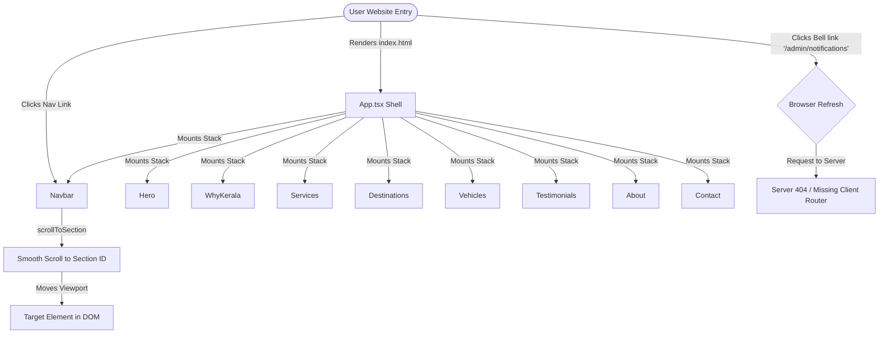
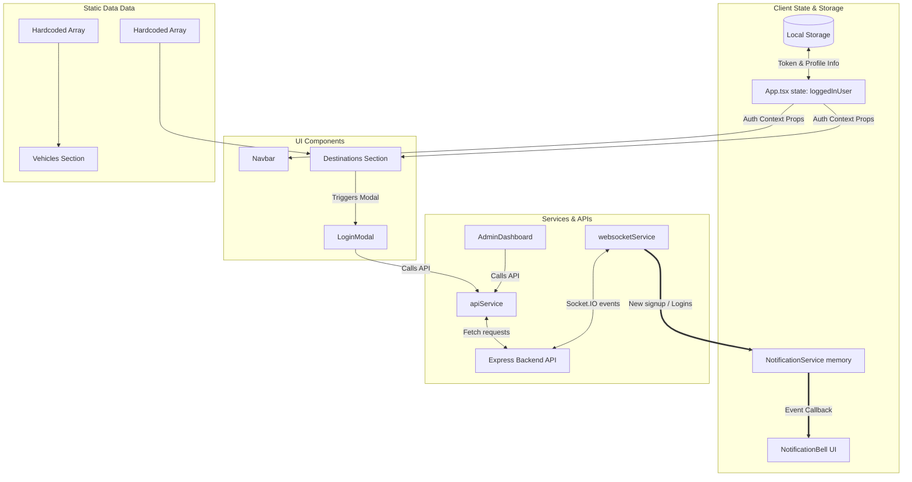

# Architecture Analysis: Green World Holidays (Frontend)

This document provides a detailed architectural review of the React + TypeScript + Vite project for **Green World Holidays**, analyzing its current implementation, bottlenecks, SEO readiness, and scalability as it prepares to grow from 20 to 100+ landing pages.

---

## 1. Current Folder Structure

The project has a standard directory skeleton in `frontend/src`, but there are significant deviations in how folders are populated:

| Folder | Purpose | Current Usage & Observations |
| :--- | :--- | :--- |
| **`assets`** | Static assets compiled by Vite | Contains only `green world notification sound.mp3`. Other site-wide images are loaded directly via Cloudinary CDN URLs in the components. |
| **`components`** | Reusable UI components | **Overpopulated.** Contains both small reusable components (e.g., `NotificationBell.tsx`, `AdminIcon.tsx`) and large, monolithic content sections that act as pseudo-pages (e.g., `About.tsx`, `Destinations.tsx`, `Services.tsx`, `Vehicles.tsx`). Also contains the entire `AdminDashboard.tsx` dashboard. |
| **`pages`** | Page-level view containers | **Underutilized / Orphaned.** Contains `Home.tsx` and `NotificationsPage.tsx`. However, neither is imported or rendered by the main application shell (`App.tsx` or `main.tsx`). The homepage layout is defined directly in `App.tsx`. |
| **`services`** | API clients, WebSockets, and state managers | Well-structured. Contains `api.ts` (REST API service client), `websocketService.ts` (Socket.IO client client), and `notificationService.ts` (in-memory notification logic). |
| **`data`** | Static config or mock data files | Contains `staticData.ts` which provides mock users and statistics for the admin dashboard. Other major data arrays (destinations, vehicles, testimonials) are hardcoded inside their respective UI components. |
| **`types`** | TypeScript definitions | Contains `index.ts` declaring types for `User`, `UserStats`, and `UsersResponse`. Note that duplicate declarations for these types are also written in `services/api.ts`. |
| **`utils`** | Pure helper functions and side-effects | Contains `audioUtils.ts` which manages preloading and playing notification sounds. |

---

## 2. Routing Analysis

### Current State
* **Declared Routes**: There is **no client-side routing** configured. The application runs entirely as a Single Page Application (SPA) landing page.
* **Page Loading**: All major content sections (`Hero`, `WhyKerala`, `Services`, `Destinations`, `Vehicles`, `Testimonials`, `About`, `Contact`) are mounted simultaneously in a vertical stack inside [App.tsx](file:///c:/Users/user/OneDrive/Documents/GreenWorld%20Holidays/Web%20Code/greenworld-holidays-main/frontend/src/App.tsx).
* **Navigation**: Menu links in the header scroll the viewport down to corresponding HTML elements using `element.scrollIntoView({ behavior: 'smooth' })`.
* **Orphaned Routes**:
  * [pages/Home.tsx](file:///c:/Users/user/OneDrive/Documents/GreenWorld%20Holidays/Web%20Code/greenworld-holidays-main/frontend/src/pages/Home.tsx) duplicates the landing page stack but is not imported.
  * [pages/NotificationsPage.tsx](file:///c:/Users/user/OneDrive/Documents/GreenWorld%20Holidays/Web%20Code/greenworld-holidays-main/frontend/src/pages/NotificationsPage.tsx) exists but is unreachable.
  * The [NotificationBell](file:///c:/Users/user/OneDrive/Documents/GreenWorld%20Holidays/Web%20Code/greenworld-holidays-main/frontend/src/components/NotificationBell.tsx) component uses an `<a href="/admin/notifications">` tag, which will result in a hard browser reload and a server 404 since there is no router setup to intercept the path.

### Navigation & Scroll Flow Diagram



---

## 3. Component Analysis

A detailed inspection of files in `src/components` reveals several critical observations regarding component design, code duplication, and coupling:

### Monolithic & Data-Heavy Components
* **[Destinations.tsx](file:///c:/Users/user/OneDrive/Documents/GreenWorld%20Holidays/Web%20Code/greenworld-holidays-main/frontend/src/components/Destinations.tsx)** (381 lines):
  * Hardcodes an array of 12 destination objects with large descriptions, Cloudinary URLs, and meta properties.
  * Contains a scroll-event listener that automatically triggers a login prompt modal once the section comes into view.
  * Explicitly renders the `LoginModal` and `ForgotPassword` modals, binding local state values.
* **[Vehicles.tsx](file:///c:/Users/user/OneDrive/Documents/GreenWorld%20Holidays/Web%20Code/greenworld-holidays-main/frontend/src/components/Vehicles.tsx)** (383 lines):
  * Hardcodes 15 vehicle spec configurations inside the component function scope.
  * Manages category filters and category card renders.
  * Handles WhatsApp booking link building logic.
* **[AdminDashboard.tsx](file:///c:/Users/user/OneDrive/Documents/GreenWorld%20Holidays/Web%20Code/greenworld-holidays-main/frontend/src/components/AdminDashboard.tsx)** (429 lines):
  * Contains tabs for overview stats, user details tables, paginated controllers, status toggles, user deletes, and settings panels in a single file.
  * Directly processes raw user data inputs and formatting logic.

### Duplication & Coupling Issues
* **Modal Proliferation**: Modals like `LoginModal` and `ForgotPassword` are instantiated multiple times. For example, `App.tsx` instantiates them to handle header log-ins, while `Destinations.tsx` instantiates them to handle the auto-pop scroll trigger. This spreads auth validation and modal open state across parent-child chains.
* **Tight Coupling**: Modals are nested inside the JSX structure of page sections (like `Destinations`). Modals should be mounted as page-level portals or handled via a global modal system, keeping the DOM structure clean.
* **Dead Code**: `components/WebSocketTest.tsx` is an integrated debug tool that is not rendered on any active view.

---

## 4. Data Flow

The project currently has two parallel data paradigms:

1. **Static Content Data**: Hardcoded arrays defined directly inside components (`Destinations.tsx`, `Vehicles.tsx`, `Services.tsx`, `Testimonials.tsx`).
2. **Dynamic Client-Server Data**: Handled via class-based service patterns (`apiService`, `websocketService`, `notificationService`) using REST fetches and event emitters.

### Data Flow Diagram



---

## 5. Page Architecture

Because the project runs on a single-page stack, the page architecture is flat.

```
main.tsx (App Root)
└── App.tsx (Main Layout Template)
    ├── Navbar (Fixed Header Navigation)
    ├── Hero (Splash Banner)
    ├── WhyKerala (Video & Grid Collage)
    ├── Services (Grid Layouts)
    ├── Destinations (Grid Layout & Detail Modals & Auth Modals)
    ├── Vehicles (Grid Category Filters & Details)
    ├── Testimonials (Grid Quotes)
    ├── About (Counter Achievements & Founder MD Bio)
    ├── Contact (EmailJS Form & Details)
    ├── Footer (Site Info Links)
    └── AdminIcon (Floating trigger -> mounts AdminDashboard overlay modal)
```

**Key Concerns:**
1. **Layout Scope**: Every component is loaded eagerly. A user visiting the site simply to find the contact info is forced to download all 15 vehicle images, 12 destination images, the entire About section counters, the interactive dashboard, and real-time Socket.IO dependencies immediately.
2. **No Layout Wrapper**: There is no reusable `Layout` wrapper (like standard Header/Footer layouts). Everything is wrapped inside a single `min-h-screen` div in `App.tsx`.

---

## 6. Service Layer

The service layer is the most cohesive part of the frontend project:

* **[api.ts](file:///c:/Users/user/OneDrive/Documents/GreenWorld%20Holidays/Web%20Code/greenworld-holidays-main/frontend/src/services/api.ts)**:
  * Employs an `ApiService` class wrapping native `fetch` requests.
  * Handles authentication token injection via the `Authorization` header.
  * Handles environment variables (`import.meta.env.PROD`) to toggle the base API URL between `https://greenworld-holidays.onrender.com/api` and `/api` (proxied in Vite).
* **[websocketService.ts](file:///c:/Users/user/OneDrive/Documents/GreenWorld%20Holidays/Web%20Code/greenworld-holidays-main/frontend/src/services/websocketService.ts)**:
  * Implements a singleton wrapping `socket.io-client`.
  * Manages reconnect intervals and forwards Socket.IO events to subscribers.
* **[notificationService.ts](file:///c:/Users/user/OneDrive/Documents/GreenWorld%20Holidays/Web%20Code/greenworld-holidays-main/frontend/src/services/notificationService.ts)**:
  * Acts as a central store for notifications in client memory.
  * Triggers the notification bell sound from `audioUtils.ts`.

### Service Layer Problems
1. **Redundant Auth Parsers**: Token checks and profile reads from `localStorage` are duplicated. They are executed independently in `App.tsx`, `AdminIcon.tsx`, `AdminDashboard.tsx`, and `websocketService.ts`. This logic needs to be centralized into an `AuthProvider`.
2. **Double Audio Load**: `audioUtils.ts` attempts to load `/sounds/notification.mp3` on compilation (outside the React lifecycle). In production, this can lead to network errors if the sound assets are not ready or preloaded.

---

## 7. SEO Readiness

For a site planning to grow to **100+ landing pages**, the current architecture represents a **major blocker**. Below is an SEO checklist analysis of the current code:

| SEO Aspect | Status | Findings & Problems |
| :--- | :--- | :--- |
| **Routing** | ❌ **Failed** | Search engine crawlers only see a single page: `/`. Detail views for Munnar, Alappuzha, Kovalam, etc., are loaded conditionally in modals and cannot be indexed as distinct URLs. |
| **URL Structure** | ❌ **Failed** | No path structure (e.g. `/destinations/munnar-hills` or `/fleet/innovacrysta`). Crawlers cannot build a sitemap structure. |
| **Dynamic Pages** | ❌ **Failed** | No templates for `/destinations/:slug` or `/vehicles/:slug`. |
| **Metadata** | ⚠️ **Partial** | `Hero.tsx` uses `react-helmet-async` to inject metadata, but it is hardcoded to the homepage: `Kerala Travel Packages | Green World Holidays`. Because it's hardcoded, all sub-sections share the exact same metadata. |
| **Breadcrumbs** | ❌ **Missing** | There are no breadcrumbs supporting category navigation for crawlers. |
| **Schema Support** | ❌ **Missing** | No structured schema markup (JSON-LD) for LocalBusiness, TouristAttraction, or VehicleRental. |
| **Image Optimization** | ⚠️ **Partial** | Images are fetched from Cloudinary (which provides fast delivery), but they are loaded as static URLs without responsive sizes (`srcset`), modern webp format conversion scripts, or explicit width/height tags (causing layout shifts). |

---

## 8. Scalability Analysis

### The Goal
* 100 Destination pages
* 50 Vehicle pages
* 20 Service pages
* 200 Blog pages

### Will the current architecture support this?
**No.** Building this on the current layout will result in:

1. **SEO Invisibility**: Google cannot index the 100 destinations, 50 vehicles, and 200 blog posts because they do not have separate URLs. A crawler will only see the home page content.
2. **Severe Performance degradation**:
   * Eager loading 100+ destinations with pictures will balloon the DOM node count, lowering Core Web Vitals score (specifically LCP - Largest Contentful Paint).
   * Bundle size will increase exponentially because static text data is compiled directly into the main Javascript bundle, rather than requested from an API or JSON config files.
3. **Difficult Content Updates**: Changing the price of a vehicle or fixing a typo in a destination description requires a code modification, pull request, and site redeployment.
4. **Poor Mobile UX**: A long page rendering hundreds of sections will cause performance lag, layout shifts, and heavy bandwidth usage on mobile connections.

---

## 9. Architecture Problems (Ranked by Severity)

### Severity 1: Critical Blockers (Must Fix Immediately)
1. **Lack of client-side routing**: All views are mounted on `/`. Dynamic subpages do not exist.
2. **Hardcoded content arrays**: Content data is directly embedded in UI component files.
3. **No Dynamic SEO configuration**: Single-page structure prevents unique page indexing, page titles, and descriptions.

### Severity 2: Major Issues
4. **Distributed Authentication State**: No centralized authentication store (`AuthContext` or `useAuth` hook). `localStorage` parsing and state management are duplicated across multiple parent/child files.
5. **Monolithic Component Structure**: `AdminDashboard`, `Destinations`, and `Vehicles` combine page logic, filter state, data configurations, and pop-up handling in single files.
6. **Orphaned Files / Dead Code**: Unrendered pages (`Home.tsx`, `NotificationsPage.tsx`, `WebSocketTest.tsx`) inflate bundle size and create developer confusion.

### Severity 3: Technical Debt
7. **Direct DOM Manipulation for Notifications**: `Destinations.tsx` dynamically appends a custom DOM div element directly to `document.body` for notifications instead of using a standard state-based React framework (like `react-toastify`, which is installed but unused).
8. **Direct Script Side-effects**: `audioUtils.ts` runs preloading functions instantly when the file is parsed by the bundler, rather than waiting for a user action or system mount.

---

## 10. Improvement Roadmap

### Phase 1: Establish Core Abstractions (Keep & Refactor)
* **What to Keep**:
  * Tailwind CSS configuration and custom styling in `index.css`.
  * The class-based service architecture for `apiService` and `websocketService`.
  * Cloudinary CDN for media assets.
* **What to Delete**:
  * Unused page templates: `pages/Home.tsx` and `pages/NotificationsPage.tsx` (to be replaced by clean routing pages).
  * Unused debugging components: `components/WebSocketTest.tsx`.
* **What to Create**:
  * **`src/context/AuthContext.tsx`**: A context provider that centralizes token verification, roles management, login state, and logouts.
  * **`src/data/` data-split**: Extract `destinations.ts`, `vehicles.ts`, `services.ts`, and `testimonials.ts` static arrays out of components.

### Phase 2: Implement Client Routing & Code Splitting
* **Configure React Router**:
  * Set up `BrowserRouter` in `main.tsx`.
  * Restructure layout so that pages are lazy-loaded via `React.lazy()` to reduce initial bundle sizes.
* **Create Route Definitions**:
  * `/` (Home page)
  * `/destinations` (Grid view)
  * `/destinations/:slug` (Individual destination landing page)
  * `/fleet` (Vehicle categories and lists)
  * `/fleet/:slug` (Individual vehicle page)
  * `/services` (Tourism and rental services overview)
  * `/blog` (Blog index)
  * `/blog/:slug` (Blog article detail page)
  * `/about` & `/contact` (Dedicated landing pages)
  * `/admin/dashboard` & `/admin/notifications` (Protected admin routes)

### Phase 3: SEO Integration & Component De-coupling
* **Dynamic Helmet Metadata**: Configure `<Helmet>` inside `/destinations/:slug` and `/fleet/:slug` to render target page-specific meta descriptions, canonical URLs, and Open Graph tags.
* **Schema Markup Helpers**: Create a utility to render JSON-LD structural data for destinations, trips, and rental vehicles.
* **Modal Portals / Context**: Build a dynamic modal provider so that login/register triggers can be called cleanly from anywhere using a hook (e.g., `const { openLogin } = useModal()`) without importing modal components into individual page sections.
